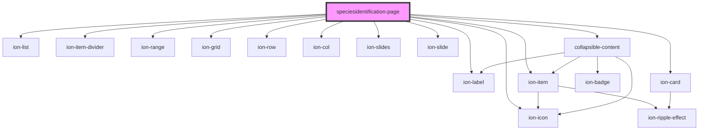

# speciesidentification-page

<!-- Auto Generated Below -->

## Properties

| Property     | Attribute    | Description | Type     | Default     |
| ------------ | ------------ | ----------- | -------- | ----------- |
| `asseturl`   | `asseturl`   |             | `string` | `'./data/'` |
| `dataurl`    | `dataurl`    |             | `string` | `'./data/'` |
| `httpheader` | `httpheader` |             | `any`    | `{}`        |
| `json`       | `json`       |             | `any`    | `undefined` |

## Methods

### `new() => Promise<void>`

#### Returns

Type: `Promise<void>`

## Dependencies

### Depends on

- ion-list
- ion-item-divider
- ion-label
- ion-item
- ion-icon
- ion-range
- ion-grid
- ion-row
- ion-col
- ion-slides
- ion-slide
- ion-card
- [collapsible-content](../collapsible-content)

### Graph

----------------------------------------------

*Built with [StencilJS](https://stenciljs.com/)*
