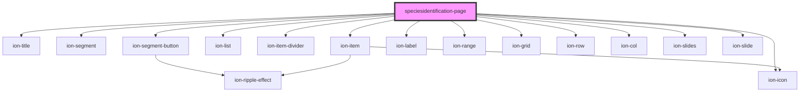

# speciesidentification-page

<!-- Auto Generated Below -->

## Dependencies

### Depends on

- ion-title
- ion-segment
- ion-segment-button
- ion-list
- ion-item-divider
- ion-item
- ion-icon
- ion-label
- ion-range
- ion-grid
- ion-row
- ion-col
- ion-slides
- ion-slide

### Graph

----------------------------------------------

*Built with [StencilJS](https://stenciljs.com/)*
